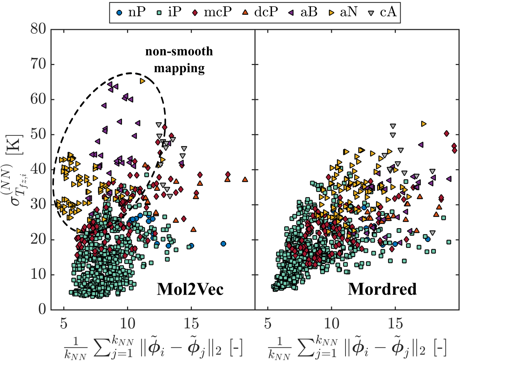

# Descriptors

> **Implementation map**
>
> | Concept | Code |
> |---|---|
> | Choice of descriptor | `DESCRIPTOR` (`cgan/config.py`) |
> | Mordred computation and cache | `compute_mordred`, `mordred_raw`, `_mol_3d` (`cgan/descriptors.py`) |
> | Fixed list of columns | `mordred_columns`, `data/descriptors/mordred_columns.txt` |
> | Mol2Vec | `mol2vec_descriptors` |
> | Standardisation | `build_dataset` (`cgan/data.py`) |
> | New species at prediction time | `mordred_transform`, `new_species_descriptors` |

Each species is represented by a vector of `L` descriptors. `L` is the **latent dimension** `ds.latent_dim` of the model: 347 for
`tfz`, `dcn` and `dcn_tfz`, 300 for Mol2Vec. In the paper the descriptors of a species are the vector **φ** (standardised: **φ̃**), and the descriptors of a blend enter through **Φ** (see [Model architecture](Model-architecture.md#mixture-encoder)). The flag `DESCRIPTOR` in `cgan/config.py` (or `--descriptor` on `train_final.py`)
chooses between `mordred` (default) and `mol2vec`.

## Mordred

Mordred descriptors are the molecular representation of the pure compounds because they give a smoother mapping between the descriptor space and the freezing point than Mol2Vec: in the local-neighbourhood analysis of the paper, the dispersion of the labels among the nearest neighbours of a compound grows steadily with their distance in Mordred space, while Mol2Vec has clusters of chemically close molecules with very different freezing points.



*Standard deviation of the T<sub>fz</sub> labels in the k<sub>NN</sub> = 31 neighbourhood of each pure compound against the mean distance of the standardised descriptors, for Mol2Vec (left) and Mordred (right). nP, iP, mcP, dcP, aB, aN, cA: n-paraffins, iso-paraffins, monocycloparaffins, dicycloparaffins, alkylbenzenes, alkylnaphthalenes, cycloaromatics.*

### Computation

`compute_mordred` computes all the Mordred descriptors (1D, 2D and 3D; `Calculator(descriptors, ignore_3D=False)`) of a
list of SMILES. The 3D descriptors need a conformer, built by `_mol_3d`:

1. parse the SMILES with RDKit and add the hydrogens;
2. embed with ETKDG v3, `randomSeed = 42`, random initial coordinates;
3. optimise with MMFF94 (at most 500 iterations); if MMFF94 has no parameters for the molecule, UFF is used instead.

A molecule that cannot be parsed or embedded, or for which Mordred fails, gives a row of missing values. All the values are converted
to numbers (non-numeric results become NaN).

### Mordred cache

The raw descriptors of the 1047 species of the databases are shipped in `data/descriptors/mordred_raw.csv.gz` (a `SMILES` column and
1826 descriptor columns). `mordred_raw` reads the cache and computes only the species that are missing from it.

```bash
python -m cgan.descriptors --kind mordred             # build the cache for the species of both databases
python -m cgan.descriptors --kind mordred --recompute # ignore the shipped cache and recompute every descriptor
```

> **Warning.** With `--recompute` the cache is rewritten with the species of the requested tasks only. Use the default `--tasks`
> (both databases): `--tasks tfz --recompute` would drop the species that only appear in the DCN database from the cache.

The 3D descriptors depend on the RDKit conformer generator, so descriptors recomputed with another RDKit version differ slightly from
the shipped ones, and so do the trained models. The inference bundles store everything needed for prediction, so the shipped weights do not
depend on the cache.

### Columns

All the models use the same 347 columns, listed in `data/descriptors/mordred_columns.txt`, so that a species has the same vector **φ** whichever model is used.
Missing values are replaced by the median of the column over the species of the model.

## Mol2Vec

`mol2vec_descriptors` gives a 300-dimensional embedding: each molecule is converted to a "sentence" of Morgan substructure
identifiers (radius 1, `mol2alt_sentence`) and the vectors of the words are summed; words that are not in the pre-trained model are
replaced by `UNK`. It needs `gensim`, `mol2vec` and `model_300dim.pkl` (see [Installation](Installation.md#optional-mol2vec)). There is no
all the 300 dimensions are used, and there is no cache. Models trained with Mol2Vec are written to `results/final/<model>_mol2vec/`.

## Standardisation

`build_dataset` standardises the descriptors over the species vocabulary of the model: subtract the column mean and divide by the
standard deviation (unbiased). Columns whose standard deviation is below `1e-8` are divided by 1, so that they stay at zero. The
mean and the standard deviation are stored in the dataset and in the bundle (`desc_mean`, `desc_std`).

## New species

At prediction time the species that are not in the training vocabulary get their descriptors computed on the fly (`mordred_transform`):

1. the raw Mordred descriptors come from the shipped cache if the species is there (also if it is in the other database), otherwise they are computed. The cache is **not** updated;
2. only the columns stored in the bundle (`descriptor_info["columns"]`) are kept;
3. missing values are replaced with the medians stored in the bundle (`descriptor_info["medians"]`), computed on the training species;
4. the result is standardised with the `desc_mean` and `desc_std` of the bundle.

The code does not check whether a new species is inside the range of the training descriptors: a species very different from the
training ones is described like any other, and the predictive distribution does not warn about it.
