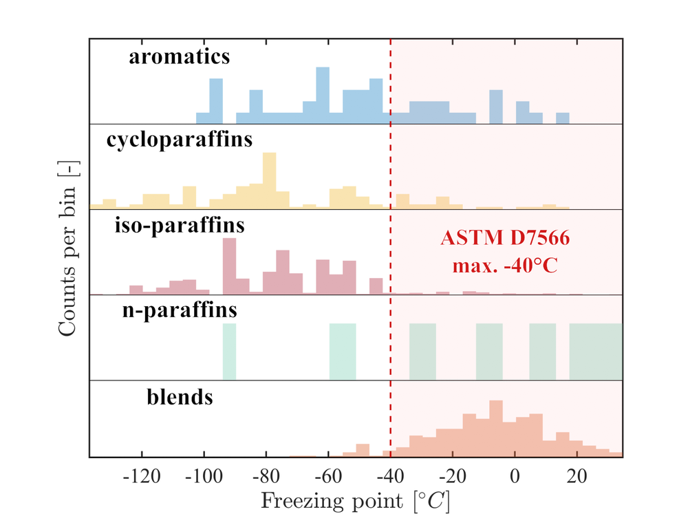
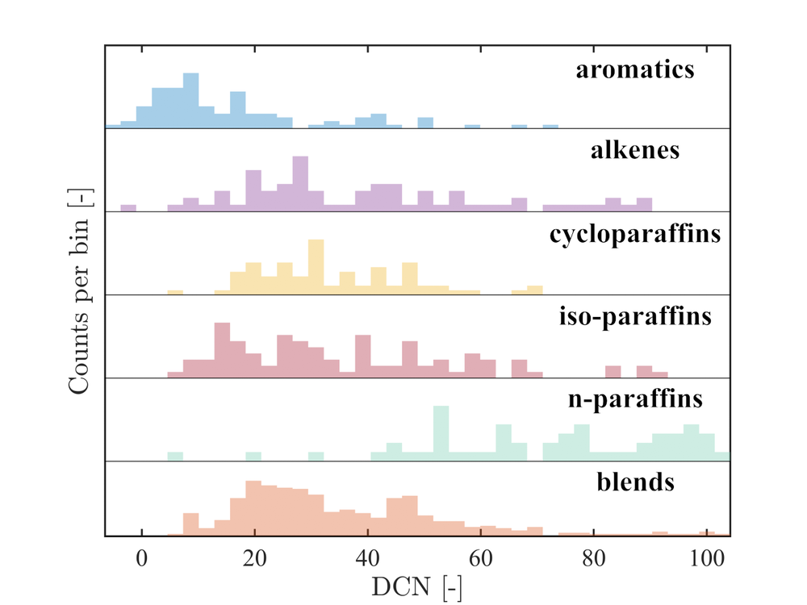

# Input data

> **Implementation map**
>
> | Concept | Code |
> |---|---|
> | Folders and paths | `cgan/config.py` (`DATA_DIR`, `DESCRIPTOR_DIR`) |
> | Reading the databases | `load_dcn`, `load_tfz`, `_blend_rows` (`cgan/data.py`) |
> | Species vocabulary | `species_vocabulary` (`cgan/data.py`) |
> | Model-ready dataset | `Dataset`, `build_dataset` (`cgan/data.py`) |

Every sample of the databases is a **composition**: a dictionary `{SMILES: volume fraction}`. A pure compound is a composition with
one component and fraction 1. The two properties have their own database; a multi-task model reads both.

## Folders

```
data/
├── dcn/            derived cetane number
│   ├── pure_species.csv        name,smiles (254 rows)
│   ├── pure_DCN.npy            (254, 9) array of DCN values, NaN where there is no measurement
│   ├── blends_components.txt   Python list of the SMILES of the 37 blend components
│   ├── blends_ids.txt          one blend identifier per line (543 lines)
│   ├── blends_vi.csv           (543, 37) volume fractions, no header
│   └── blends_DCN.csv          (543,) DCN of each blend, no header
├── tfz/            freezing point
│   ├── pure_smiles.txt         Python list of SMILES, UTF-16 encoded (898 entries)
│   ├── pure_names.txt          one name per line (898 lines)
│   ├── pure_Tfz.csv            (898,) freezing point [K], no header, NaN where missing
│   ├── blends_components.txt   Python list of the SMILES of the 19 blend components
│   ├── blends_ids.txt          one blend identifier per line (261 lines)
│   ├── blends_vi.csv           (261, 19) volume fractions, no header
│   └── blends_Tfz.csv          (261,) freezing point [K] of each blend, no header
└── descriptors/
    ├── mordred_raw.csv.gz      raw Mordred descriptors of 1047 species (cache)
    └── mordred_columns.txt     the 347 columns used by the models
```

## Units and content

| | Property | Unit | Pure compounds | Blends |
|---|---|---|---|---|
| `dcn` | derived cetane number | dimensionless | 254 compounds, 386 measurements (up to 9 values per compound), range -20 to 110 | 543 blends, range 7.3 to 101.5 |
| `tfz` | freezing point | K | 893 measurements (898 rows, 5 without a value), range 129.35 to 352.38 | 261 blends, range 204.75 to 308.33 |

Composition of the blends:

- `tfz`: 251 binary and 10 ternary blends.
- `dcn`: 296 binary, 114 ternary, 123 with four components, 6 with five, 2 with six, 1 with eight and 1 with nine.



*Distribution of the freezing points of the pure compounds, by molecular group, and of the blends. The dashed line is the ASTM D7566 limit (-40 °C).*



*Distribution of the derived cetane numbers of the pure compounds, by molecular group, and of the blends.*

## How a database becomes samples

- **Pure compounds.** Each non-missing value is one sample with a single component of fraction 1. In `dcn`, a compound with
  several measurements gives several samples with the same identifier (the name). In `tfz`, the rows without a value (NaN) are
  skipped.
- **Blends.** `blends_vi.csv` is read as a matrix of volume fractions, one row per blend and one column per entry of
  `blends_components.txt`. Each row is **renormalised to sum to 1**. The components of a blend are the columns with a positive
  fraction. A blend whose property value is NaN is skipped.
- **Whitespace** in SMILES (including non-breaking spaces) is removed (`clean_smiles`).
- **Targets** are z-scored per task, with the mean and the standard deviation over all the samples of that task, pure compounds
  and blends together. The statistics are stored in the dataset and in the bundles (`y_mean`, `y_std`) so that the predictions
  return to physical units.

The number of samples and species that result:

| Model | Samples | Distinct species | Descriptors |
|---|---|---|---|
| `tfz` | 1154 (893 pure + 261 blends) | 890 | 347 |
| `dcn` | 929 (386 pure + 543 blends) | 249 | 347 |
| `dcn_tfz` | 2083 | 1047 (92 are in both databases) | 347 |

The 254 pure compounds of `dcn` correspond to 249 distinct SMILES: some names are written with the same structure.

## The species vocabulary

`species_vocabulary(tasks)` lists the distinct SMILES that appear in the samples of the requested tasks, in order of first
appearance (the tasks in the order given). The vocabulary fixes the rows of the descriptor matrix `Z_species`, on which the descriptors
are standardised (see [Descriptors](Descriptors.md#standardisation)).

In the `Dataset`, each sample stores the component indices `comp_idx` (padded with -1) and the fractions `comp_frac`, with the
components of a sample sorted by species index.

## Adding data

To add measurements for a property that already exists, append rows to the files of its folder, keeping the files aligned (same
row for the identifier, the fractions and the value). For a blend with a new component, add its SMILES to `blends_components.txt`
and a new column to `blends_vi.csv`. The raw descriptors of any new species are computed when needed (see
[Descriptors](Descriptors.md#mordred-cache)). A new property needs a loader in `cgan/data.py`, an entry in `LOADERS`, in
`config.TASKS` and a model in `config.MODELS` with its `configs/<model>.csv`.
