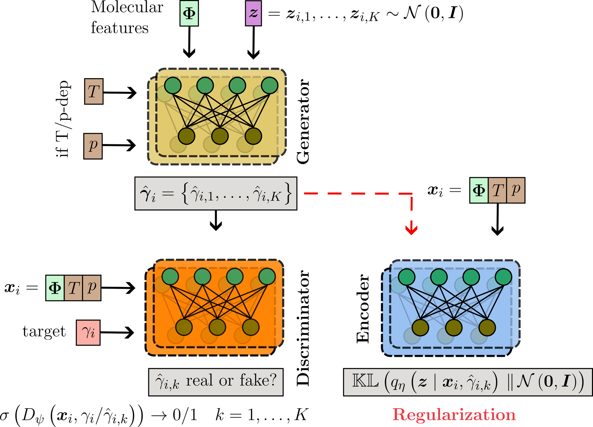
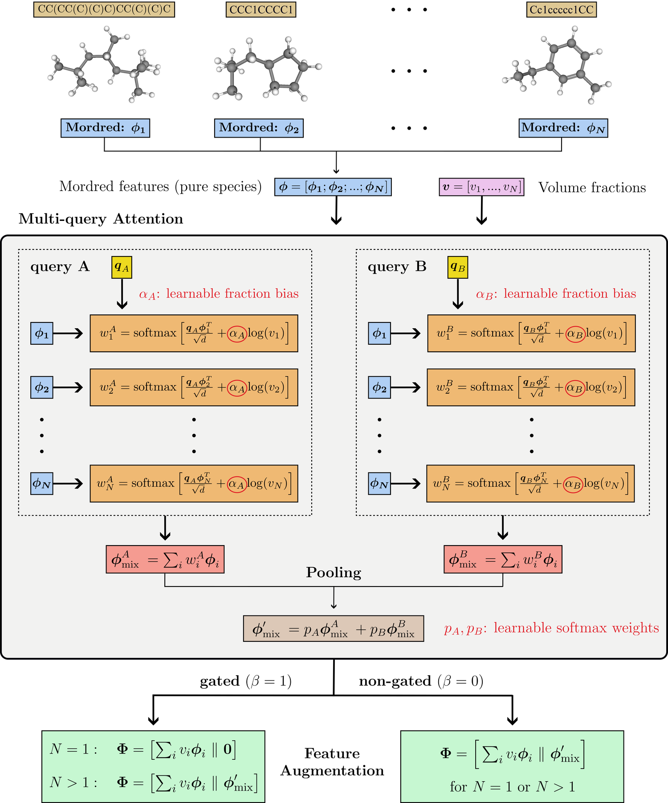
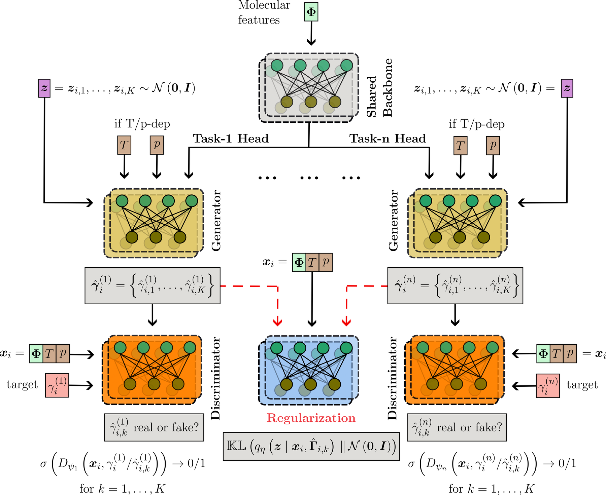

# Model architecture

> **Implementation map**
>
> | Concept | Code |
> |---|---|
> | Mixture features **Φ** (volume-fraction mean + multi-query attention pooling, gate β<sub>t</sub>) | `MixtureEncoder`, `MultiQueryPooling` (`cgan/models.py`) |
> | Generator f<sub>θ</sub> (one head per task, optional shared backbone) | `Generator`, `BridgeNet`, `SharedTrunk` |
> | Discriminator D<sub>ψ</sub> of one task | `Critic` |
> | Latent-space encoder q<sub>η</sub> | `MLP` with `use_residual=True`, attribute `net_E` of `CGAN` |
> | Assembly, input of the networks | `CGAN`, `CGAN.encode` (`cgan/trainer.py`) |
> | Hyperparameters | `HyperParameters` (`cgan/trainer.py`), `configs/<model>.csv` |
>
> The symbols are those of the paper; [Notation](Notation.md) lists them with the names of the code.

The conditional GAN has four kinds of networks: the **mixture encoder** that builds the fuel features **Φ**, the **generator** f<sub>θ</sub> (called `net_D` in the code),
one **discriminator** D<sub>ψ<sub>t</sub></sub> per task (`net_Ts`) and a **latent-space encoder** q<sub>η</sub> (`net_E`). Only the mixture encoder and the generator are
needed to predict. Below, L is the number of descriptors per species (`ds.latent_dim`), b the batch size, n the number of tasks and
256 the dimension of the latent vector **z** (`features`).



*Single-task architecture (`tfz`, `dcn`): for the i-th sample K latent vectors **z**<sub>i,k</sub> give K generated values γ̂<sub>i,k</sub> = f<sub>θ</sub>(**x**<sub>i</sub>, **z**<sub>i,k</sub>), which the discriminator compares with the measured γ<sub>i</sub> and the encoder maps back to the latent space.*

## Mixture encoder

Input: for each sample, the species indices of its components (padded with -1), their volume fractions v<sub>i</sub>, the standardised descriptor
matrix `Z_species` (the vectors **φ**<sub>i</sub>) and the task of the sample.



*Construction of the fuel features **Φ** for a mixture of N components, with two queries (Q = 2) for the sake of illustration.*

1. The fractions of the real components are renormalised to sum to 1 (padding gets fraction 0).
2. **Volume-fraction-weighted mean**: Σ<sub>i</sub> v<sub>i</sub>**φ**<sub>i</sub> (`mean_pool`), shape `(b, L)`.
3. **Multi-query attention pooling** (`MultiQueryPooling`), with Q = `num_queries` learnable queries **q**<sub>A</sub>, **q**<sub>B</sub>, … of dimension L. The component
   embeddings are both keys and values. For query A and component i the attention weight is

   $$w_i^A = \mathrm{softmax}_i\left[\frac{\boldsymbol{q}_A\cdot\boldsymbol{\phi}_i}{\sqrt{L}} + \alpha_A \log v_i\right]$$

   where α<sub>A</sub> is a learnable fraction bias per query (`frac_scale`, initialised at 0.5), so that the composition enters the attention. In the code the
   fraction is floored at `1e-12` inside the logarithm, and padding is masked with `-inf`. The pooled vector of query A is **φ**<sup>A</sup><sub>mix</sub> = Σ<sub>i</sub> w<sub>i</sub><sup>A</sup>**φ**<sub>i</sub>.
   The Q pooled vectors are combined with learnable softmax weights p<sub>A</sub>, p<sub>B</sub>, … (`query_w`, uniform at initialisation):
   **φ**′<sub>mix</sub> = p<sub>A</sub>**φ**<sup>A</sup><sub>mix</sub> + p<sub>B</sub>**φ**<sup>B</sup><sub>mix</sub> + … (`attn_pool`, shape `(b, L)`). The module is invariant to the order of the components.
4. **Gate β<sub>t</sub>** (`blend_gate`, `config.TASKS`): `blend_delta = attn_pool * scale`, with `scale = is_blend` for a gated task (β<sub>t</sub> = 1)
   and `scale = 1` for a non-gated task (β<sub>t</sub> = 0). `is_blend` is 1 when the sample has more than one component and 0 for a pure compound, so for a
   gated task the attention correction is exactly zero for pure compounds and they send no gradient to the attention branch.

The output is the feature augmentation **Φ** = [Σ<sub>i</sub> v<sub>i</sub>**φ**<sub>i</sub> ‖ **φ**′<sub>mix</sub>] (the pair `(mean_pool, blend_delta)`). `CGAN.encode` concatenates it with
`N_AUX = 2` columns of zeros (reserved for T and p, always zero for the properties considered here) into the input **x** = [**Φ**; T, p] of shape
`(b, 2L + 2)`.

The gate of each task is set by `config.TASKS`: `dcn` is non-gated, `tfz` is gated. In the multi-task model the gate is applied
per sample, according to the task of the sample.

## Generator

Input (**x**, **z**), with **z** ~ N(**0**, **I**) of dimension 256. Only the first `2L` columns of **x** are used (the reserved columns are ignored). The
generator returns one value per task, in z-scored units.

Each task has its own head, `BridgeNet`, a two-stage residual MLP:

```
[h, z] -> Linear -> LayerNorm -> act                       (gateway, width m_G,1)
       -> N_G,1 residual blocks of width m_G,1 -> Linear   (stage 1)
       -> Linear(m_G,1 -> m_G,2) -> LayerNorm -> act       (bridge)
       -> N_G,2 residual blocks of width m_G,2 -> Linear(m_G,2 -> 1)  (stage 2, output)
```

A residual block is `x + fc2(dropout(act(fc1(x))))`, with dropout rate d<sub>r</sub> (`dropout`). In `configs/<model>.csv`: m<sub>G,1</sub> = `neurons_trunk`, N<sub>G,1</sub> = `num_layers_trunk`,
m<sub>G,2</sub> = `neurons_D`, N<sub>G,2</sub> = `num_layers_D`.

- **Single-task models** (`tfz`, `dcn`): `h = x[:, :2L]`, the head input has dimension `2L + 256`.
- **Multi-task model** (`dcn_tfz`): `h` is the output of the **shared backbone** (`SharedTrunk`): `Linear(2L -> m_bb) -> LayerNorm -> act`,
  N<sub>bb</sub> residual blocks, `Linear`, with m<sub>bb</sub> = `neurons_shared` and N<sub>bb</sub> = `num_layers_shared`. Every head takes `[h, z]`.

The same **z** is given to all the heads for a sample, so that the samples of the different tasks of the same draw are generated from one latent vector.



*Multi-task architecture (`dcn_tfz`): a shared backbone upstream of the task-specific generator heads, one discriminator per task and a single shared encoder. The same **z**<sub>i,k</sub> feeds all the heads, and the same **x**<sub>i</sub> all the discriminators and the encoder.*

## Discriminators

One discriminator per task (`Critic`): an `MLP` that scores the pair (**x**, γ) (input dimension `2L + 2 + 1`). It has an input layer, N<sub>𝒟</sub> = `num_layers_T`
hidden layers of width m<sub>𝒟</sub> = `neurons_T` (each Linear + LayerNorm + activation) and a linear output, with **spectral normalisation** on every
linear layer and no residual connections. By the convention of the loss (see [Training](Training.md#losses)) the output is **low for real pairs and high for generated pairs**.

## Latent-space encoder

`net_E` is a residual `MLP` with N<sub>E</sub> = `num_layers_E` blocks of width m<sub>E</sub> = `neurons_E`. It maps `[x, y_gen]` (dimension `2L + 2 + n`, where `y_gen` is
the generated value, set to zero for the tasks without a label) to a vector of dimension 256. It is used only in the training loss
(latent-space regularisation) and is not needed to predict. In the multi-task model a single encoder is shared by the tasks.

## Activation functions

`activation` in the configuration is one of `relu`, `elu`, `gelu`, `tanh`. An unknown name gives an identity in the `MLP` (discriminators, latent
encoder) and a ReLU in the generator (`BridgeNet`, `SharedTrunk`), so use one of the four names.

## Weights initialisation

Every `Linear` layer of an `MLP`, `SharedTrunk` and `BridgeNet` is initialised with Xavier-uniform weights and zero biases. The attention
queries are drawn from N(0, 1).

## Sizes of the three final models

| | `tfz` | `dcn` | `dcn_tfz` |
|---|---|---|---|
| descriptors L | 347 | 347 | 347 |
| generator input **x** (used columns) | 694 | 694 | 694 |
| attention queries Q | 2 | 1 | 1 |
| shared backbone, m<sub>bb</sub> x N<sub>bb</sub> | none | none | 256 x 2 |
| generator stage 1, m<sub>G,1</sub> x N<sub>G,1</sub> | 128 x 2 | 256 x 1 | 64 x 2 |
| generator stage 2, m<sub>G,2</sub> x N<sub>G,2</sub> | 128 x 1 | 128 x 2 | 64 x 1 |
| discriminator, m<sub>𝒟</sub> x N<sub>𝒟</sub> | 64 x 4 | 64 x 4 | 256 x 2 (per task) |
| latent encoder, m<sub>E</sub> x N<sub>E</sub> | 64 x 1 | 64 x 1 | 32 x 2 |
| latent dimension | 256 | 256 | 256 |
| activation, dropout d<sub>r</sub> | ReLU, 0 | ReLU, 0 | ReLU, 0 |
