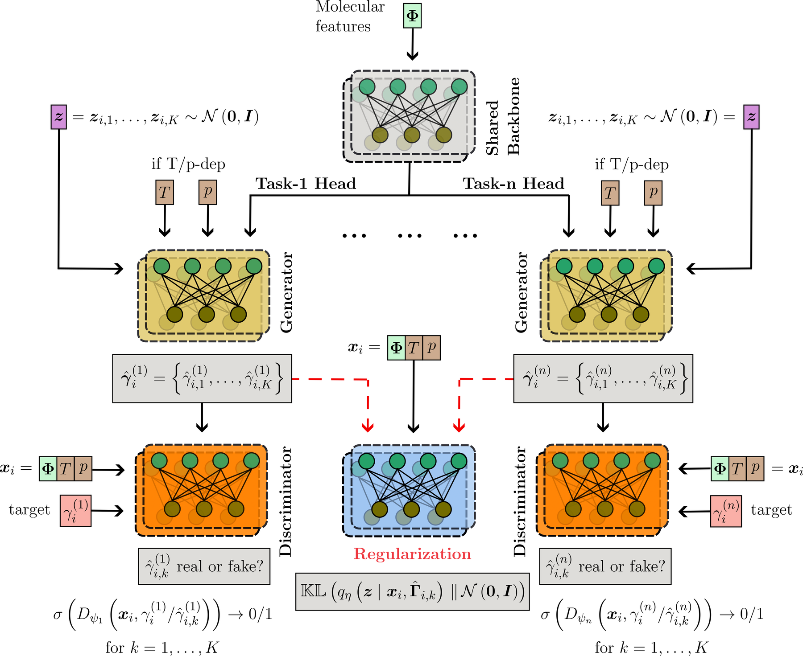

# c-GAN for SAF property prediction: documentation

This repository contains a **conditional generative adversarial network (c-GAN) with attention pooling** that predicts the
*distribution* of a property of a pure hydrocarbon or of a blend, from the molecular structure (SMILES) and the volume fractions of
its components. It is used for two properties of sustainable aviation fuels (SAFs): the **derived cetane number** (DCN) and the
**freezing point** (Tfz).

> Liberatori J., Iavarone S., Vicquelin R., *Uncertainty-aware sustainable aviation fuel property prediction using a
> conditional generative adversarial network with attention pooling*, Energy & Fuels (submitted for publication).

## In one paragraph

Every pure compound is described by a vector of Mordred descriptors (or by a Mol2Vec embedding). A blend is described by the
descriptors of its components, pooled in two ways: the volume-fraction-weighted mean, and a correction obtained by multi-query
attention pooling. The generator takes this mixture representation and a latent noise vector `z` and returns one sample of the
property; repeating the draw with different `z` gives the predictive distribution. The generator is trained against one
discriminator per property and a latent-space encoder, with a softmin-of-K reconstruction loss.

*Multi-task architecture; the single-task models have one generator and one discriminator, see [Model architecture](Model-architecture.md).*
 The final models of the
paper are three: freezing point alone, DCN alone, and DCN + freezing point in one multi-task network.

## What the repository contains

| Included | Not included |
|---|---|
| final training of the three models of the paper on the whole databases, with the hyperparameters selected in the paper | the nested k-fold cross-validation used to select the hyperparameters (described in Section 2.5 of the paper) |
| prediction of new pure compounds and blends from an inference bundle | the trained weights (archived on Zenodo, [10.5281/zenodo.24087390](https://doi.org/10.5281/zenodo.24087390)) |
| the two property databases and the cached Mordred descriptors | |

## Pages

### Using the code

| Page | Content |
|---|---|
| [Installation](Installation.md) | requirements, environment, optional packages |
| [Quick start](Quick-start.md) | train a model, predict a blend, outputs of a run |
| [Prediction](Prediction.md) | `predict.py`: input formats, new species, what the output means |
| [Configuration reference](Configuration-reference.md) | `cgan/config.py` and every column of `configs/<model>.csv` |
| [Input data](Input-data.md) | the two databases: files, formats, units, counts |
| [API reference](API-reference.md) | modules, classes and functions |
| [Development](Development.md) | repository layout, reproducibility, how to extend |

### What the code does

| Page | Content |
|---|---|
| [Notation](Notation.md) | the symbols of the paper and the names of the code |
| [Descriptors](Descriptors.md) | Mordred (fixed list of 347 columns) and Mol2Vec, standardisation, new species |
| [Model architecture](Model-architecture.md) | mixture features with attention pooling, generator, discriminators, latent encoder |
| [Training](Training.md) | hyperparameter selection, losses, update schedule, batching, checkpoint on the CRPS, bundles |

Each of the last three pages starts with a table that maps the concepts to the code, and the symbols are those of the paper (see [Notation](Notation.md)). For the
motivation and the validation of the method see the paper.

## The three models

| Model | Tasks | Hyperparameters | Gate βt | Mordred columns |
|---|---|---|---|---|
| `tfz` | freezing point | `configs/tfz.csv` | gated (1) | fixed list (347) |
| `dcn` | derived cetane number | `configs/dcn.csv` | non-gated (0) | fixed list (347) |
| `dcn_tfz` | DCN and freezing point (multi-task) | `configs/dcn_tfz.csv` | DCN non-gated, Tfz gated | fixed list (347) |

The gate βt is explained in [Model architecture](Model-architecture.md#mixture-encoder).

## Status

Python 3.12 with the package versions in `requirements.txt` (the versions used to produce the results of the paper). Runs on CPU or on a
CUDA GPU.
