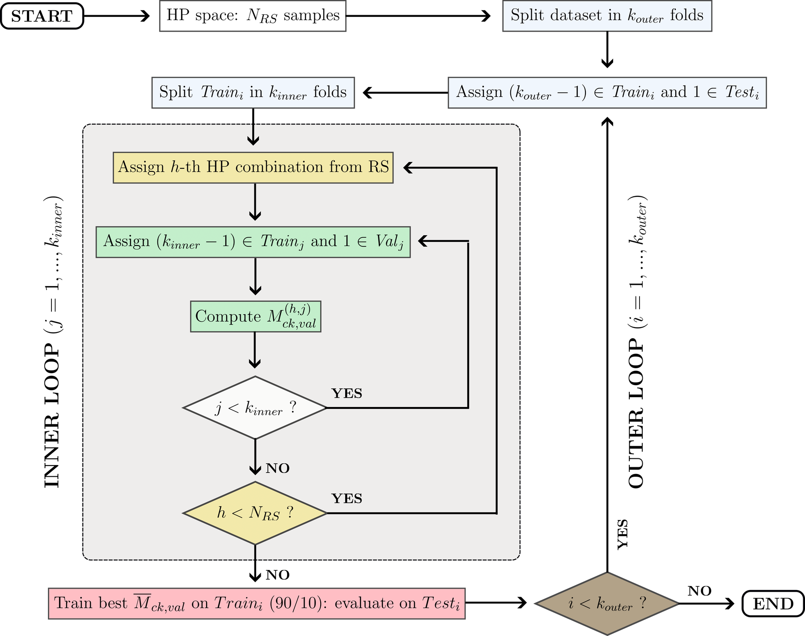

# Training

> **Implementation map**
>
> | Concept | Code |
> |---|---|
> | Entry point | `train_final.py` |
> | Final training, checkpoint, bundles | `run_final_training`, `train_with_checkpoint`, `save_bundle` (`cgan/final_training.py`) |
> | Training loop | `fit_final` (`cgan/trainer.py`) |
> | Epoch: batches, discriminator and generator updates | `CGAN.train_epoch` |
> | Losses | `CGAN.critic_loss`, `CGAN.generator_loss` |
> | Metrics (CRPS, coverage, ...) | `CGAN.evaluate`, `crps_ensemble`, `central_interval` |
> | Batches, determinism, checkpoint | `cgan/utils.py` |

This page describes the final training of the three models: each model is trained on **the whole database(s)**, without a validation set,
with the hyperparameters of `configs/<model>.csv`.

## Hyperparameters

The hyperparameters in `configs/<model>.csv` were selected with a nested k-fold cross-validation (k<sub>outer</sub> = 5, k<sub>inner</sub> = 3), which also gives unbiased estimates of the generalisation performance and is not part of this repository. The outer folds group the samples by fuel, so that all the replicate measurements of a compound or blend are in the same fold. In every outer loop N<sub>RS</sub> = 160 configurations are sampled at random; each is trained in the k<sub>inner</sub> inner loops, and the one with the lowest mean validation CRPS is retrained on a 90/10 split of the outer-training folds and evaluated on the held-out fold. The configuration of each model is the most frequent one over the outer folds.



*Nested k-fold cross-validation for the selection of the hyperparameters and the unbiased estimate of the generalisation performance.*

The final training described below uses the whole database: no validation subset is held out, and the checkpoint metric M<sub>ck</sub> is evaluated on the training data.

## Command

```bash
python train_final.py                    # tfz, dcn and dcn_tfz, one after the other
python train_final.py --models dcn_tfz   # one model (tfz, dcn or dcn_tfz)
python train_final.py --descriptor mol2vec --out results/mol2vec
```

| Option | Default | Meaning |
|---|---|---|
| `--models` | all three | models to train |
| `--descriptor` | `config.DESCRIPTOR` (`mordred`) | `mordred` or `mol2vec` |
| `--out` | `results/final` | output folder; each model writes to `<out>/<model>/` (`<out>/<model>_mol2vec/` with Mol2Vec) |

For each model the script: loads the hyperparameters, enables determinism with `config.SEED`, builds the dataset and calls
`run_final_training`.

## One epoch

For every mini-batch of b = `batch_size` samples:

1. **Expansion.** Each sample is repeated K = 32 times (`K_SAMPLES`), each copy with its own latent vector **z**<sub>i,k</sub> ~ N(**0**, **I**), so that the
   losses can compare the target with 32 generated values.
2. **Discriminator updates.** u<sub>𝒟</sub> updates of the discriminators, with the mixture representation detached.
3. **Generator/encoder updates.** u<sub>𝒢/ℰ</sub> updates of the mixture encoder, the generator and the latent encoder; the mixture encoder is re-run, so that each step has its own graph.

(u<sub>𝒟</sub>, u<sub>𝒢/ℰ</sub>) follows from `k1_over_k2` = r: (`int(r)`, 1) if r >= 1 and (1, `int(1/r)`) otherwise. `k1_over_k2 = 2` gives two discriminator updates
per generator update; `0.5` gives one discriminator update per two generator updates.

The discriminators and the generator side use two Adam optimisers, with the two-time-scale update rule (learning rates 10<sup>`lr_T`</sup> = l<sub>r,𝒟</sub> and 10<sup>`lr_G`</sup> = l<sub>r,𝒢/ℰ</sub>, see
[Configuration reference](Configuration-reference.md)). The gradient norm is clipped to 10 for the discriminators and for each of the mixture encoder, generator and
latent encoder.

### Batches

- **Single-task models**: random batches of the whole database, reshuffled every epoch, and the **last incomplete batch is dropped** (`drop_last`): the latent term of the loss is computed over the batch
  and is unreliable on a very small batch.
- **Multi-task model**: balanced batches with the same number of samples of each task, `max(1, batch_size // n_tasks)` per task. The number of
  batches per epoch is set by the task with fewer samples (the DCN database: 929 samples against 1154), so an epoch does not visit all the samples
  of the larger database; the shuffling changes every epoch, so all the samples are used over the epochs.

## Losses

Let γ be the target (z-scored), γ̂<sub>k</sub> the K = 32 generated values of a sample and f<sub>Θ</sub><sup>(t)</sup> the generator of task t. Tasks without a label in a sample are ignored (NaN-aware losses); the
losses are averaged over the tasks that have labels in the batch.

**Discriminator (`critic_loss`)**, per task t:

```math
\mathcal{L}_{\mathcal{D}} = -\Big[\,\mathbb{E}\log\left(1-\sigma(D_{\psi_t}(\boldsymbol{x},\gamma))\right) + \mathbb{E}\log\sigma\left(D_{\psi_t}(\boldsymbol{x},\hat\gamma)\right)\Big]
```

where the generated values are detached. The discriminator is trained to give a low score to real pairs and a high score to generated pairs.

**Generator and encoder (`generator_loss`)**, per task t:

```math
\mathcal{L}_{\mathcal{G}}^{(t)} = \mathbb{E}\left[-\log\left(1-\sigma(D_{\psi_t}(\boldsymbol{x},\hat\gamma))\right)\right] + (1-\lambda)\,\mathrm{log\_q} + \beta\,\mathcal{L}_{recon}^{(t)}
```

and the total is the mean over the tasks (`nanmean`). In the code the adversarial term is written `softplus(D(x, γ̂))`, which equals the non-saturating form above, and
β is the column `beta` of the configuration (1 for all the final models, not the gate β<sub>t</sub>).

- **Adversarial term**: the generator is trained to obtain a low score, as the real pairs.
- **Latent-space regularisation** `log_q = 0.5 * sum_d (1 + log var_d - mu_d^2 - var_d)`, where `mu` and `var` are the mean and the variance, over the batch, of the output
  of the latent encoder q<sub>η</sub>, `net_E([x, y_gen])` (dimension 256). It equals −KL(N(`mu`, `var`) ‖ N(**0**, **I**)), so with λ > 1 the term
  (1 − λ) `log_q` is a KL penalty of weight λ − 1 (all the final models use λ = 1.5, a weight of 0.5).
- **Softmin-of-K reconstruction** with a mean anchor:

  ```math
  \mathcal{L}_{recon}^{(t)} = -\tau_t\log\sum_{k=1}^{K}\exp\left[-\frac{(\hat\gamma_k-\gamma)^2}{\tau_t}\right] + \tau_t\log K + \alpha_t\Big[\frac{1}{K}\sum_{k=1}^{K}\hat\gamma_k-\gamma\Big]^2
  ```

  For a small τ<sub>t</sub> the first two terms approach the squared error of the *best* of the K samples: the generator is asked to cover the target with some of its samples, not to concentrate all of
  them on it. The last term anchors the mean of the samples to the target. τ<sub>t</sub> (`tau`) and α<sub>t</sub> (`alpha_mean`) are per task.

## Metrics

At the end of every epoch, `CGAN.evaluate` runs on the training samples (batches of `batch_size`, a fixed random order, K = 32 generated values per sample) and computes, per task:

| Metric | Meaning |
|---|---|
| `crps` | ensemble CRPS in z-scored units, `mean|y_k - y| - 0.5 mean|y_k - y_l|` over the `K` samples |
| `crps_orig` | the same in physical units |
| `rmse`, `mae`, `r2` | errors of the generated values against the target, `r2` against the mean of the targets of the batch |
| `cov95`, `cov50` | fraction of targets inside the central 95% and 50% interval of the generated values |
| `width95` | mean width of the 95% interval, physical units |
| `loss_G`, `loss_T` | generator and discriminator losses |

## Learning-rate schedule

The learning rates of both optimisers are halved (`ReduceLROnPlateau`, patience 10, factor 0.5, threshold 0) when the mean generator loss
(for the generator optimiser) or the mean discriminator loss (for the discriminator optimiser) of the epoch has not decreased for 10 epochs. The loss
of a mini-batch is that of the last update of the batch.

## Checkpoint and stopping

After every epoch the CRPS in z-scored units, **averaged over the tasks and computed on the training data**, is compared with the best one so far.
When it is lower, the weights of all the networks are saved to `best_global.pt`. Training stops after `MAX_EPOCHS = 1000` epochs, or after
`PATIENCE = 100` epochs without improvement. The weights of the best epoch are then loaded back.

Because the model is trained on the whole database, this CRPS is a training-set score. It is a criterion to choose the epoch, not an estimate of the
error on new data.

## Reproducibility

`train_final.py` calls `enable_determinism(SEED = 42)` before building the dataset: it seeds Python, NumPy and PyTorch, sets cuDNN to deterministic mode,
disables its autotuner, sets `CUBLAS_WORKSPACE_CONFIG` and `torch.use_deterministic_algorithms(True)`. The seed is set again before training (a `seed`
column in the configuration file overrides `SEED`), and the seed of the epoch `e` is `seed + e`. The result also depends on the PyTorch version, on the hardware (CPU or GPU) and, for the descriptors, on the RDKit
version: bitwise identical weights should not be expected on a different machine.

## Outputs

`<out>/<model>/` contains:

| File | Content |
|---|---|
| `best_global.pt` | weights of the best epoch (all the networks, plus the epoch and the score) |
| `bundle_<task>.pt` | inference bundle of each task: one for the single-task models, two for `dcn_tfz` (`bundle_dcn.pt`, `bundle_tfz.pt`) |
| `history.csv` | per epoch: `epoch`, `crps`, `rmse` (means over the tasks), `loss_G`, `loss_T` |
| `config.csv` | the hyperparameters used |
| `predictions_<task>.csv` | `fuel`, `measured`, `mean`, `std`, `q2.5`, `q97.5` for every labelled training sample (1000 Monte Carlo draws, physical units; replicates of a compound appear in separate rows) |

The bundle (`save_bundle`) is a PyTorch file with: the hyperparameters, the task id and names, the gates, the descriptor kind and its information
(`descriptor_info`: columns and medians), the species vocabulary and its standardised descriptors, the descriptor mean and standard deviation, the target
mean and standard deviation, and the state of the mixture encoder and of the generator. It is self-contained: `predict.py` needs nothing else.

The progress is printed at the end of the run only (best CRPS and epoch); follow `history.csv` while the run is going.
